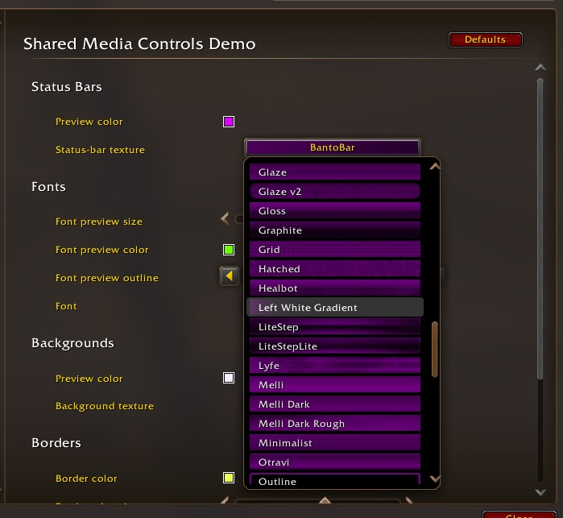
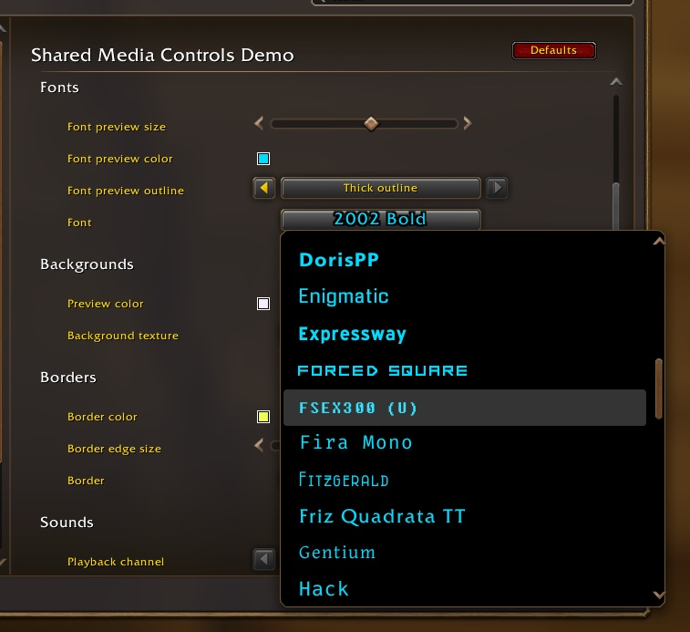
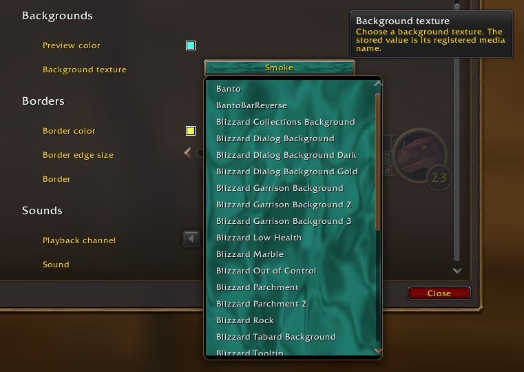
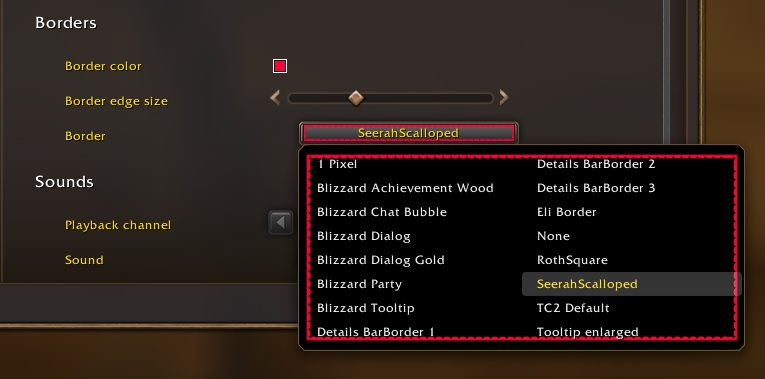
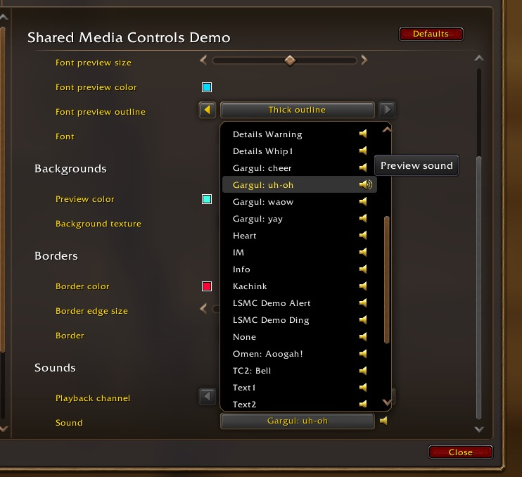

# LibSharedMediaControls-1.0

Native Blizzard Settings selectors for LibSharedMedia status-bar textures,
fonts, backgrounds, borders, and sounds in WoW Forever.

MIT licensed. Copyright (c) 2026 Orionshock. See [License](#license) for
the separate notices covering bundled dependencies.

## Screenshots

| Status Bars | Fonts |
| --- | --- |
|  |  |
| **Backgrounds** | **Borders** |
|  |  |
| **Sounds** | |
|  | |

## Loading

The standalone library package includes a Demo.

For embedding, load only `LibSharedMediaControls-1.0.lua` after LibStub and
LibSharedMedia-3.0 (which requires CallbackHandler-1.0), before your Settings setup.
`Blizzard_Settings_Shared` must be available when calling constructors.

```lua
local LSMC = LibStub("LibSharedMediaControls-1.0")
local LSM = LibStub("LibSharedMedia-3.0")
```

## Common contract

Each constructor adds a dropdown to the supplied vertical-layout category and
returns its native Settings initializer. Do not register it again or share it
between rows; call the constructor separately for each selector.

The primary string setting stores an LSM media **name**, never a path. Selection
calls `setting:SetValue(name)`. The library handles enumeration and previews;
your addon retains persistence and applies the selected media to its own UI.

Optional companions are native Settings objects and are read-only to the library.
Their formats and defaults are listed below. Pass `nil` for skipped positional
arguments, such as font color without font size.

The returned initializer supports native methods such as `AddSearchTags()`.
Leave the library-owned `InitFrame`, `Resetter`, `customOptionHandler`, and
`getSelectionTextFunc` handlers intact.

## Status-bar textures

```lua
LSMC:CreateStatusbarDropdown(category, setting, tooltip, colorSetting)
```

Uses LSM's `"statusbar"` registry. Each option and the selected control display
its texture behind the media name.

| Optional companion | Value | Default |
| --- | --- | --- |
| `colorSetting` | String, `AARRGGBB` | Gray: `(0.45, 0.45, 0.45, 1)` |

Preview RGB is multiplied by 0.45 for label readability, including when a color
companion is supplied. Alpha passes through unchanged. This affects only the
preview, not the consuming addon's bar.

Color changes update the selected preview live. Menu rows read the current
texture and tint when initialized; reopen the menu to refresh all rows. Labels
are capped at 400 pixels. Missing selected media leaves its saved name visible
without artwork; menu entries use LSM's normal fallback.

## Background textures

```lua
LSMC:CreateBackgroundDropdown(category, setting, tooltip, colorSetting)
```

Uses LSM's `"background"` registry. One texture fills the open menu behind all
options. Opening starts with the current selection; hovering another option
changes the preview without selecting it. The last hovered texture remains
until another hover or menu close. The closed control shows the selected texture.

| Optional companion | Value | Default |
| --- | --- | --- |
| `colorSetting` | String, `AARRGGBB` | Original texture colors |

Tint applies directly, without status-bar dimming. Backgrounds stretch to fit the
preview; they do not tile. Bright artwork can reduce label contrast. `"None"`
clears the artwork.

Color changes update the selected preview live. Hover another option or reopen
to refresh the menu tint. The menu texture is compositor-managed and released on
close. Reopening always reads the current selection, not the last hovered name.
The preview does not replace Blizzard's menu frame or border.

## Fonts

```lua
LSMC:CreateFontDropdown(category, setting, tooltip, sizeSetting, colorSetting, outlineSetting)
```

Uses LSM's `"font"` registry. Media names render in their registered fonts in both
the menu and selected control.

| Optional companion | Value | Default |
| --- | --- | --- |
| `sizeSetting` | Number, font size in pixels | 14 |
| `colorSetting` | String, `AARRGGBB` | White |
| `outlineSetting` | String: `""`, `"OUTLINE"`, or `"THICKOUTLINE"` | No outline |

Preview size is clamped to 8-32 in the menu and 8-18 in the selected control.
Other outline values render without an outline. These limits do not alter the
companion settings. Labels are capped at 400 pixels; long names can truncate.

All three companions update the selected preview live. Reopen the menu to refresh
all its labels. Inline color markup preserves the companion color through native
hover and selection styling; stored names remain plain text.

The library reuses Font objects and applies them with `SetFontObject()` because
the menu compositor prohibits `SetFont()` on attached FontStrings. On release,
the selected label's original font object and color are restored. Registered
fonts and glyph coverage are assumed usable. If LSM returns no font path, the
saved name remains visible in Blizzard's native font.

## Borders

```lua
LSMC:CreateBorderDropdown(category, setting, tooltip, colorSetting, edgeSizeSetting)
```

Uses LSM's `"border"` registry. An isolated `BackdropTemplate` renders the fetched
texture as backdrop edges and corners inside the native menu boundary. It does
not replace Blizzard's menu border or background.

Opening previews the current selection. Hovering changes only the menu preview;
clicking selects the media name. The last hovered border remains until another
hover or close. `"None"` clears the preview. The closed control has its own small
border preview.

| Optional companion | Value | Default |
| --- | --- | --- |
| `colorSetting` | String, `AARRGGBB` | White |
| `edgeSizeSetting` | Number, backdrop edge size in pixels | 12 |

Edge size controls corner dimensions and edge thickness, not the preview frame's
width or height. Menu edges are clamped to 1-32 pixels; the short selected control
caps them at 8. Large edges occupy more of the preview interior. Labels and native
highlights draw above the menu preview, which does not intercept mouse input.

Companion changes update the selected preview live. Hover another option or
reopen to apply them to the menu preview. The menu child comes from
`AttachTemplate("BackdropTemplate")`; its backdrop and size-change script are
cleared before compositor release. The selected preview is cleared and hidden
when its Settings row is released.

## Sounds

```lua
LSMC:CreateSoundDropdown(category, setting, tooltip, channelSetting)
```

Uses LSM's `"sound"` registry. Clicking a name selects it; clicking its speaker
previews it without changing selection or closing the menu. A speaker beside the
closed dropdown previews the current selection. Opening, hovering, and selecting
do not automatically preview audio; normal Blizzard menu feedback can still play.

| Optional companion | Value | Default |
| --- | --- | --- |
| `channelSetting` | String: `"Master"`, `"SFX"`, `"Music"`, `"Ambience"`, or `"Dialog"` | `"SFX"` |

Each speaker click fetches the current sound and channel, then calls
`PlaySoundFile()`. LSM supports `.ogg`/`.mp3` paths and numeric file IDs. `"None"`
uses LSM's silent file ID 1 and is skipped; missing fetched values are also silent.
Saved names remain visible even when no longer registered. Channel enable and
volume settings still apply; the library changes no audio CVars and provides no
volume control.

Each selector owns one playback handle shared by its menu and closed-control
speakers. A new preview stops the previous one with `StopSound()`. Menu release
and control hide also stop playback. Buttons and icon textures inside the menu
are compositor-managed; the closed-control button is hidden and disconnected
when its Settings row is released.

Playback started beside a closed dropdown is not tied to an unrelated menu's
lifetime. Opening another dropdown while that control remains visible does not
stop it. Separate sound selectors have independent handles and do not stop one
another's closed-control previews.

## Expanded examples

See [Demo.lua](Demo.lua) for all five constructors with companion controls and
selection callbacks. The demo is an ordinary consumer
of the public API; embedding the library does not load it.

## Refresh behavior

Reopen a dropdown to discover newly registered media or changes to LSM global
overrides. Companion changes update the selected preview live; reopen the menu
to refresh all options. Sound previews read the channel when clicked.

## Standalone demo

Run `/lsmc` to open the demo. [Demo.lua](Demo.lua) is example code demonstrating
all five selectors and their full set of companion options: texture tinting,
font size/color/outline, border color/edge size, and sound playback channels.
It includes hover previews, speaker buttons, selection callbacks, and persistence.

## License

Original library and demo code and project documentation are distributed under
the [MIT License](LICENSE), copyright (c) 2026 Orionshock. Retain the copyright
and permission notice when embedding the library; it is included in the Lua header.

Bundled dependencies retain their original authorship and license notices in
`libs/`. LibSharedMedia-3.0 is LGPL 2.1; CallbackHandler-1.0 carries the Ace3 BSD
notice; LibStub's source declares it public domain and its existing accompanying
notice is retained. The MIT grant does not relicense those dependencies or
Blizzard's APIs and code. See each dependency's source header and license file.
